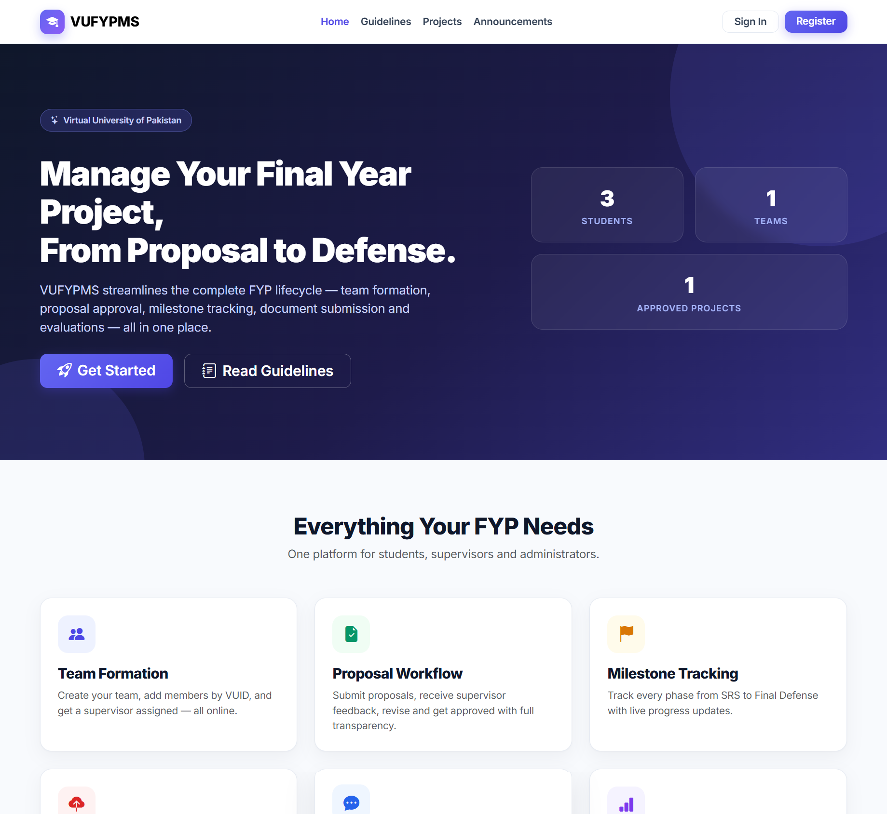

# VUFYPMS — Final Year Project Management System

A Laravel-based academic project designed to help manage the **Final Year Project (FYP)** lifecycle at a university, from team formation and proposals through milestones, submissions, and evaluation.

**Tech stack:** Laravel 12 · PHP · MySQL  
**User areas:** Guest · Student · Supervisor · Admin  
**Project type:** Academic / portfolio project

## Preview



## Overview

VUFYPMS (Virtual University Final Year Project Management System) organizes FYP-related information in one web application. The interface presents role-specific areas for students, supervisors, and administrators, along with public information for guests.

The project is intended to make the project lifecycle easier to follow, from the initial proposal toward final defense.

## Core workflows

The project interface highlights the following workflows:

- **Team formation:** Organizing student teams and their membership.
- **Proposal workflow:** Handling project proposals and supervisor feedback.
- **Milestone tracking:** Following progress from early documentation to final defense.
- **Project information:** Presenting guidelines, projects, and announcements.
- **Documentation and evaluation:** Supporting the submission and review stages of the FYP lifecycle.

> **Implementation note:** This section describes the workflows presented by the project. Please check the repository's current code before describing any feature as fully implemented or production-ready.

## User roles

| Role | Area of the system |
| --- | --- |
| **Guest** | Public project information and entry points for sign-in/registration. |
| **Student** | Student-focused FYP management workflows. |
| **Supervisor** | Supervision and review-related workflows. |
| **Admin** | Administrative project-management workflows. |

## Technologies

| Component | Technology |
| --- | --- |
| Backend framework | Laravel 12 |
| Server-side language | PHP |
| Database | MySQL |

## Getting started (local development)

The steps below follow a standard Laravel workflow. Your local environment and the repository's actual configuration may require adjustments.

### Prerequisites

- PHP 8.2 or newer (compatible with Laravel 12)
- Composer
- MySQL
- Node.js and npm, **if** your frontend assets require building

### 1. Clone the repository

```bash
git clone https://github.com/mtalhaahad-prog/vufypms.git
cd vufypms
```

### 2. Install PHP dependencies

```bash
composer install
```

### 3. Create your environment file

On macOS/Linux:

```bash
cp .env.example .env
```

On Windows Command Prompt:

```bat
copy .env.example .env
```

Generate an app key:

```bash
php artisan key:generate
```

### 4. Configure MySQL

Create a local database, then update the database connection values in `.env`:

```dotenv
DB_CONNECTION=mysql
DB_HOST=127.0.0.1
DB_PORT=3306
DB_DATABASE=vufypms
DB_USERNAME=your_local_db_username
DB_PASSWORD=your_local_db_password
```

Never commit your real `.env` file or credentials to GitHub.

### 5. Create the database tables

If the repository includes the required migrations, run:

```bash
php artisan migrate
```

If a SQL import or seed step is required instead, follow your project's database setup instructions.

### 6. Run the application

```bash
php artisan serve
```

Open the local address shown in your terminal (usually `http://127.0.0.1:8000`).

If the repository has a frontend build script, run the following in another terminal:

```bash
npm install
npm run dev
```

## Screenshots

The screenshot above is the VUFYPMS homepage image used in the developer's portfolio. Additional screenshots of the student, supervisor, and admin dashboards can be added as they become available.

## Development context

VUFYPMS was developed as an academic project to practice backend web development, database-driven application design, and role-based interfaces using Laravel, PHP, and MySQL.

## Author

**Muhammad Talha Ahad**  
[GitHub profile](https://github.com/mtalhaahad-prog) · [Portfolio](https://mtalhaahadportfolio.netlify.app/)
